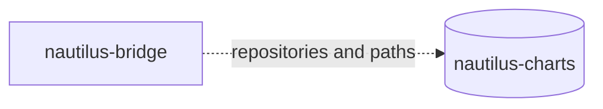

<p align="center">
  <picture>
    <source media="(prefers-color-scheme: dark)" srcset="brand/nautilus/lockup-dark.svg">
    
  </picture>
</p>

<hr/>

<p align="center">
  <picture>
    <source media="(prefers-color-scheme: dark)" srcset="brand/lockup-dark.svg">
    
  </picture>
</p>

Charts lists the Git repositories you work with, the systems they form, the external services they use, and how they depend on each other. A repository belongs to at most one system and one named catalog. Each machine keeps catalog and code-repository paths separately.

## Service map



Workflow modules use Charts. Today this is the Bridge, and Sonar is planned to use it too. The Bridge works without Charts and then asks for the target repository's local path. Charts depends on no other module and knows nothing about them.

## Entries

| Entry | Folder | Example |
| --- | --- | --- |
| System | `systems/<id>.toml` | `nautilus`, `shop` |
| Repository | `repositories/<id>.toml` | `nautilus-charts`, `shop-common-lib` |
| External | `externals/<id>.toml` | `amazon-s3` |

- One file per entry. The file name is the ID, in lowercase kebab-case, and unique across all entry types and registered catalogs.
- A repository may name its `system` and list what it `depends-on`: other repositories or externals.
- Charts derives system dependencies from repository dependencies. They are never recorded by hand.
- Repository tags come from the selected catalog's `tags.toml`.
- The source repository still has a legacy root catalog. Its entry files stay Git-ignored. Named catalogs store entries and tags in separate Git repositories.
- Each named catalog has one configured `origin` remote (`origin` is Git's local name for the remote address). Each machine maps catalog names to local folders. A code Repository belongs to one Named catalog, and entry IDs are unique across all catalogs.
- For this setup, `./folio/` is a local parent directory for named catalog repositories. Each child folder, such as `work/` or `private/`, is its own named catalog and Git repository. The source repository ignores `./folio/` so it does not track those nested repositories.
- `depends-on` links can cross catalogs. A Repository's `system` link must name a System in the same catalog.
- Catalog paths and code-repository paths stay on each machine. Git ignores each catalog's `local/paths.toml` file.
- A due read syncs all registered catalogs. The default interval is 15 minutes. A write syncs only the catalog it changes. Charts uses fast-forward sync, which updates local history only when it can move forward without a merge. A failed sync warns and keeps local data. Charts never force-pushes.
- Charts contacts only its own named catalog repositories. It never contacts or changes code repositories listed in a catalog.
- The root catalog stays available until its owner chooses which entries to migrate. Charts never removes the root automatically.

```toml
# repositories/nautilus-bridge.toml
description = "Specification workflow: drafts and approves changes and delegates them to an implementation agent."
system = "nautilus"
tags = ["utility"]
depends-on = [
  { id = "nautilus-logbook", via = "npm script" },
  { id = "nautilus-charts", via = "npm script" },
  { id = "nautilus-library", via = "npm script" },
]
```

## Use

Ask an agent, for example Pi or Claude, from this repository. The `charts` skill handles the request:

- "Where is `<repository>` on this machine?" shows the entry and its checked local path.
- "Register `<repository>` in system `<system>`" uses `charts add --catalog <name>` and checks the selected catalog.
- "Update fields on `<id>`" uses `charts set --catalog <name>` and keeps all other entry text unchanged.
- "What depends on `<id>`?" uses `charts rdeps <id> --catalog <name>` to list dependents.
- "Remove `<id>`" lists the dependents first and asks before changing anything. It never deletes the repository.

Or run the `charts` command from any folder once it is linked ([Setup](#setup)):

```bash
charts catalog create <name> --path <folder> --remote <url>
charts catalog clone <name> --path <folder> --remote <url>
charts catalog sync <name>
charts find <text> --catalog <name> [--system <id>] [--tag <tag>] [--status <status>] [--owner <text>]
charts find <id>                 # exact ID lookup across catalogs
charts show <id> [--catalog <name>]
charts deps <id> --catalog <name>
charts rdeps <id> --catalog <name>
charts check --catalog <name>
charts add <system|repository|external> <id> --catalog <name> --data '<JSON>' [--local-path <path>] [--new-tag <name>=<description>]... [--json]
charts set <id> --catalog <name> [--data '<JSON>'] [--local-path <path>] [--new-tag <name>=<description>]... [--replace-key] [--json]
charts migrate <id> --catalog <destination>
charts describe [--json]
charts --version [--json]
```

When no named catalogs are registered, commands without `--catalog` use the legacy root catalog. Once named catalogs are registered, `add`, `set`, `deps`, `rdeps`, `check`, and general text search require `--catalog`. Without it, `show <id>` and exact-ID `find <id>` search registered named catalogs only.

`add` and `set` success results identify the entry by type and ID and report validation; they do not include a Charts store path. Catalog findings name an entry or catalog part, for example `repository shop: tag "unknown" is not defined in the tag list` or `the local paths are missing; local path checks were skipped`.

For example:

```bash
charts add system shop --catalog work --data '{"description":"Online shop system."}'
```

The `--data` value is a JSON object. JSON is a text format for structured data. Include a required `description`. Do not include an `id`; pass it as the second positional value. Use only fields defined for that entry type. Charts uses the matching template and omits optional fields you do not supply. It does not generate IDs or repository keys.

Systems and repositories may set an optional `ticket-key` for an external ticket tracker. Use 2–10 characters: an uppercase letter, then uppercase letters or digits. Ticket keys are not unique and may equal a Repository's `key`. A Repository's own value takes precedence over its System's value. If neither sets a value, no ticket key resolves. `show <repository> --json` reports the resolved value and its source as `resolved_ticket_key` and `ticket_key_source`.

Use `--local-path` only for a Repository. Charts checks the selected catalog, the local path, and its relation to a recorded remote. It reads code-repository Git data locally and does not contact the code-repository remote. The Charts skill asks the catalog owner to confirm a proposed code-repository remote before it records that remote. If a Repository needs a tag missing from the selected catalog's `tags.toml`, pass `--new-tag <name>=<description>` once for each new tag. The name and description must be non-empty. The name must be lowercase kebab-case, must not already exist in that file, and must appear in the Repository's `tags` list. A new tag that the entry does not use is rejected. The Charts skill proposes the name and description and asks the catalog owner to confirm both before using the option.

Each named catalog has its own tracked `tags.toml`. Charts appends new tag definitions without changing prior text. A named-catalog write commits its entry and tag definitions in that catalog, then syncs only that catalog. If writing or validation fails, Charts restores the entry, `local/paths.toml`, and `tags.toml`. The machine-local path file stays ignored and is never committed. The legacy root catalog keeps its existing behavior.

Use `charts set <id> --catalog <name>` to add or replace fields in a named catalog. Its `--data` value is a partial JSON object. Each named field replaces the full old value; other fields stay unchanged. `--local-path` and `--new-tag` follow the repository rules above. Changing an existing repository key needs `--replace-key`; check in the Logbook that no other module uses the key, then ask the catalog owner before using this option. Charts changes only the named TOML lines, validates the destination and registered links, and restores the entry, path map, and tags when validation fails. It commits the selected catalog. A failed remote sync warns and keeps the local commit. Unsafe layouts, such as duplicate or dotted fields and TOML table sections, are refused. A request that changes nothing succeeds without writing.

Find prints one line per entry. An exact-ID Bridge lookup also returns a Repository's checked local path. Add `--json` when another tool reads a result. A sync failure prints a warning on standard error; a failed write keeps its local commit. With `--json`, a command failure prints `{"error": {"code", "message", "details"}}` and exits with 1 for a usage error, 2 for not found, 3 for a refusal, and 4 for an external failure; [docs/structure.md](docs/structure.md#errors-and-exit-codes) lists the codes. `charts check --catalog <name>` with errors exits with 3 and keeps its report as output. `charts describe --json` lists every command and error code. Catalog sync contacts only registered Charts catalog remotes. Code-repository checks use local Git data only.

## Requirements

| Needs | Without it |
| --- | --- |
| Node 26 or later | The `charts` command stops with the error code `unsupported-runtime`. The TOML files stay readable. |
| `local/paths.toml` | `show` reports no local path. Everything else works. |

## Setup

```bash
cd "$NAUTILUS_HOME/nautilus-charts"
npm ci
mkdir -p ~/.local/bin
ln -sf "$PWD/bin/charts.js" ~/.local/bin/charts
charts --version
npm run check
```

The link puts the `charts` command on `PATH` when `~/.local/bin` is on it, whichever Node version nvm has active; do not use `npm link`. Link it once per machine. The command runs with plain Node and works from any folder.

Use `charts catalog create` to start an empty named catalog, or `charts catalog clone` to copy one from its configured remote. From the Charts root, keep each catalog repository under `./folio/`, for example `./folio/work/` and `./folio/private/`. Each child folder has its own Git history and remote. The parent folder is ignored by the Charts source repository. Charts stores the name-to-folder registry at `${XDG_CONFIG_HOME:-~/.config}/nautilus-charts/catalogs.json`; each machine keeps its own copy. Due reads sync all registered catalogs every 15 minutes by default. Set `CHARTS_READ_SYNC_INTERVAL_MS` to change the interval. Use `0` to sync on every read.

The legacy root catalog stays available until its owner confirms migration. Copy one root entry at a time to its chosen child catalog with `charts migrate <id> --catalog <name>`. Migration copies needed tag definitions and this machine's local path, checks and commits the destination locally, and does not sync. Review the copied entry, then run `charts catalog sync <name>` to share it. Migration does not delete or change the root entry.

Skills live in `.agents/skills/`. The links in `.claude/skills/` are tracked. When you add a skill, create its link with this command. Use the skill's path under `.agents/skills/` as `<path>`:

```bash
ln -s ../../.agents/skills/<path> .claude/skills/<name>
```

On Windows, enable Developer Mode and run `git config --global core.symlinks true` before cloning. Otherwise, Git checks out symlinks as text files.

On a new machine, create `local/paths.toml` and add the repositories you have checked out:

```toml
nautilus-bridge = "~/code/nautilus/nautilus-bridge"
```

## Rules

[CONSTITUTION.md](CONSTITUTION.md) holds Charts' mandatory rules, including what Charts is and is not responsible for.

## Support

Charts provides fixes for the latest release only. Older versions are not supported. The maintainer reviews issues and pull requests as time allows. There is no response-time promise.

## More

- [docs/structure.md](docs/structure.md): entry fields, IDs, status values, and the `charts` command in detail.
- [CONSTITUTION.md](CONSTITUTION.md): the mandatory rules.
- [GLOSSARY.md](GLOSSARY.md): the terms Charts uses.
- [CONTRIBUTING.md](CONTRIBUTING.md): how to change Charts.
- [LICENSE](LICENSE): terms for using Charts.
- [SECURITY.md](SECURITY.md): how to report security issues.
- [CODE_OF_CONDUCT.md](CODE_OF_CONDUCT.md): community standards and reporting.
