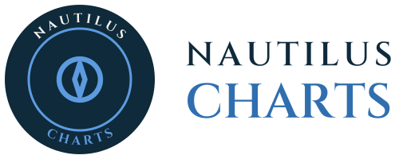
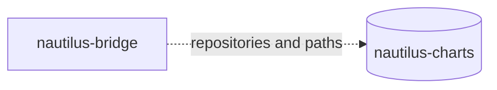

<p align="center">
  <picture>
    <source media="(prefers-color-scheme: dark)" srcset="brand/nautilus/lockup-dark.svg">
    
  </picture>
</p>

<hr/>

<p align="center">
  <picture>
    <source media="(prefers-color-scheme: dark)" srcset="brand/lockup-dark.svg">
    
  </picture>
</p>

Charts lists the Git repositories you work with, the systems they form, the external services they use, and how they depend on each other. A repository belongs to at most one system. Each machine keeps the local path of each repository separately.

## Service map



Workflow modules use Charts. Today this is the Bridge, and Sonar is planned to use it too. The Bridge works without Charts and then asks for the target repository's local path. Charts depends on no other module and knows nothing about them.

## Entries

| Entry | Folder | Example |
| --- | --- | --- |
| System | `systems/<id>.toml` | `nautilus`, `shop` |
| Repository | `repositories/<id>.toml` | `nautilus-charts`, `shop-common-lib` |
| External | `externals/<id>.toml` | `amazon-s3` |

- One file per entry. The file name is the ID, in lowercase kebab-case, and unique across all entry types.
- A repository may name its `system` and list what it `depends-on`: other repositories or externals.
- Charts derives system dependencies from repository dependencies. They are never recorded by hand.
- Repository tags come from `tags.toml`.
- Git ignores all entries. Each machine keeps its own catalog, so private systems and remotes are never published.
- `local/paths.toml` maps repository IDs to local paths on this machine. Git ignores it.

```toml
# repositories/nautilus-bridge.toml
description = "Specification workflow: drafts and approves changes and delegates them to an implementation agent."
system = "nautilus"
tags = ["utility"]
depends-on = [
  { id = "nautilus-logbook", via = "npm script" },
  { id = "nautilus-charts", via = "npm script" },
  { id = "nautilus-library", via = "npm script" },
]
```

## Use

Ask an agent, for example Pi or Claude, from this repository. The `charts` skill handles the request:

- "Where is `<repository>` on this machine?" shows the entry and its checked local path.
- "Register `<repository>` in system `<system>`" uses `charts add` and runs full catalog validation.
- "Update fields on `<id>`" uses `charts set` and keeps all other entry text unchanged.
- "What depends on `<id>`?" lists the entries that depend on a repository, external, or system.
- "Remove `<id>`" lists the dependents first and asks before changing anything. It never deletes the repository.

Or run the `charts` command from any folder once it is linked ([Setup](#setup)):

```bash
charts find [text]   # filters: --system, --tag, --status (all entry types), --owner
charts show <id>
charts deps <id>
charts rdeps <id>
charts check
charts add <system|repository|external> <id> --data '<JSON>' [--local-path <path>] [--new-tag <name>=<description>]... [--json]
charts set <id> [--data '<JSON>'] [--local-path <path>] [--new-tag <name>=<description>]... [--replace-key] [--json]
charts describe [--json]
charts --version [--json]
```

`add` and `set` success results identify the entry by type and ID and report validation; they do not include a Charts store path. Catalog findings name an entry or catalog part, for example `repository shop: tag "unknown" is not defined in the tag list` or `the local paths are missing; local path checks were skipped`.

For example:

```bash
charts add system shop --data '{"description":"Online shop system."}'
```

The `--data` value is a JSON object. JSON is a text format for structured data. Include a required `description`. Do not include an `id`; pass it as the second positional value. Use only fields defined for that entry type. Charts uses the matching template and omits optional fields you do not supply. It does not generate IDs or repository keys.

Systems and repositories may set an optional `ticket-key` for an external ticket tracker. Use 2–10 characters: an uppercase letter, then uppercase letters or digits. Ticket keys are not unique and may equal a Repository's `key`. A Repository's own value takes precedence over its System's value. If neither sets a value, no ticket key resolves. `show <repository> --json` reports the resolved value and its source as `resolved_ticket_key` and `ticket_key_source`.

Use `--local-path` only for a repository. Charts checks the full catalog, including the path and its relation to a configured remote. The Charts skill asks the catalog owner to confirm a proposed remote before it adds that remote. If a repository needs a tag missing from `tags.toml`, pass `--new-tag <name>=<description>` once for each new tag. The name and description must be non-empty. The name must be lowercase kebab-case, must not already exist in `tags.toml`, and must appear in the repository's `tags` list. A new tag that the entry does not use is rejected. The Charts skill proposes the name and description and asks the catalog owner to confirm both before using the option.

`tags.toml` is shared and tracked by Git. Charts appends new tags without changing its prior text. If writing or full-catalog validation fails, Charts removes the new entry and restores `local/paths.toml` and `tags.toml`. A successful add leaves `tags.toml` changed and uncommitted. Charts never stages or commits it; the catalog owner decides whether to commit it. The entry and path files stay ignored by Git.

Use `charts set <id>` to add or replace fields on an existing entry. Its `--data` value is a partial JSON object. Each named field replaces the full old value; other fields stay unchanged. `--local-path` and `--new-tag` follow the repository rules above. Changing an existing repository key needs `--replace-key`; check in the Logbook that no other module uses the key, then ask the catalog owner before using this option. Charts changes only the named TOML lines, validates the full catalog, and restores the entry, `local/paths.toml`, and `tags.toml` when validation fails. Unsafe layouts, such as duplicate or dotted fields and TOML table sections, are refused. A request that changes nothing succeeds without writing.

Find prints one line per entry. Add `--json` when another tool reads a result. With `--json`, a failure prints `{"error": {"code", "message", "details"}}` and exits with 1 for a usage error, 2 for not found, 3 for a refusal, and 4 for an external failure; [docs/structure.md](docs/structure.md#errors-and-exit-codes) lists the codes. `charts check` with errors exits with 3 and keeps its report as output. `charts describe --json` lists every command and error code. The command uses local Git data only. It never contacts remote servers, clones, or fetches.

## Requirements

| Needs | Without it |
| --- | --- |
| Node 26 or later | The `charts` command stops with the error code `unsupported-runtime`. The TOML files stay readable. |
| `local/paths.toml` | `show` reports no local path. Everything else works. |

## Setup

```bash
cd "$NAUTILUS_HOME/nautilus-charts"
npm ci
mkdir -p ~/.local/bin
ln -sf "$PWD/bin/charts.js" ~/.local/bin/charts
charts --version
npm run check
```

The link puts the `charts` command on `PATH` when `~/.local/bin` is on it, whichever Node version nvm has active; do not use `npm link`. Link it once per machine. The command runs with plain Node and works from any folder.

The catalog starts empty. Add systems, repositories, and externals with `charts add`, or ask the `charts` skill to register them. Git ignores your entries, so back them up yourself, for example in a private repository.

Skills live in `.agents/skills/`. For Claude Code, link them into the ignored `.claude/skills/`:

```bash
mkdir -p .claude/skills
for skill in .agents/skills/charts .agents/skills/engineering/*; do
  ln -sfn "../../$skill" ".claude/skills/$(basename "$skill")"
done
```

On a new machine, create `local/paths.toml` and add the repositories you have checked out:

```toml
nautilus-bridge = "~/code/nautilus/nautilus-bridge"
```

## Rules

[CONSTITUTION.md](CONSTITUTION.md) holds Charts' mandatory rules, including what Charts is and is not responsible for.

## More

- [docs/structure.md](docs/structure.md): entry fields, IDs, status values, and the `charts` command in detail.
- [CONSTITUTION.md](CONSTITUTION.md): the mandatory rules.
- [GLOSSARY.md](GLOSSARY.md): the terms Charts uses.
- [CONTRIBUTING.md](CONTRIBUTING.md): how to change Charts.
