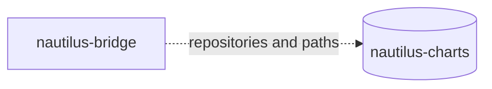

<p align="center">
  <picture>
    <source media="(prefers-color-scheme: dark)" srcset="brand/nautilus/lockup-dark.svg">
    
  </picture>
</p>

<hr/>

<p align="center">
  <picture>
    <source media="(prefers-color-scheme: dark)" srcset="brand/lockup-dark.svg">
    
  </picture>
</p>

Charts lists the Git repositories you work with, the systems they form, the external services they use, and how they depend on each other. A repository belongs to at most one system. Each machine keeps the local path of each repository separately.

## Service map



The Bridge is the only module that uses Charts. It works without Charts and then asks for the target repository's local path. Charts depends on no other module and knows nothing about them.

## Entries

| Entry | Folder | Example |
| --- | --- | --- |
| System | `systems/<id>.toml` | `nautilus`, `shop` |
| Repository | `repositories/<id>.toml` | `nautilus-charts`, `shop-common-lib` |
| External | `externals/<id>.toml` | `amazon-s3` |

- One file per entry. The file name is the ID, in lowercase kebab-case, and unique across all entry types.
- A repository may name its `system` and list what it `depends-on`: other repositories or externals.
- Charts derives system dependencies from repository dependencies. They are never recorded by hand.
- Repository tags come from `tags.toml`.
- Git ignores all entries. Each machine keeps its own catalog, so private systems and remotes are never published.
- `local/paths.toml` maps repository IDs to local paths on this machine. Git ignores it.

```toml
# repositories/nautilus-bridge.toml
description = "Specification workflow: drafts and approves changes and delegates them to an implementation agent."
system = "nautilus"
tags = ["utility"]
depends-on = [
  { id = "nautilus-logbook", via = "npm script" },
  { id = "nautilus-charts", via = "npm script" },
  { id = "nautilus-library", via = "npm script" },
]
```

## Use

Ask an agent, for example Pi or Claude, from this repository. The `charts` skill handles the request:

- "Where is `<repository>` on this machine?" shows the entry and its checked local path.
- "Register `<repository>` in system `<system>`" creates the entry from `templates/` and runs `check`.
- "What depends on `<id>`?" lists the entries that depend on a repository, external, or system.
- "Remove `<id>`" lists the dependents first and asks before changing anything. It never deletes the repository.

Or run the script directly from the Charts root:

```bash
npm run --silent charts -- find [text]   # filters: --system, --tag, --status, --owner
npm run --silent charts -- show <id>
npm run --silent charts -- deps <id>
npm run --silent charts -- rdeps <id>
npm run --silent charts -- check
```

Output is one line per entry. Add `--json` when another tool reads the result.

## Requirements

| Needs | Without it |
| --- | --- |
| Node 20 or later | The `charts` script does not run. The TOML files stay readable. |
| `local/paths.toml` | `show` reports no local path. Everything else works. |

The script uses local Git data only. It never contacts remote servers, clones, or fetches.

## Setup

```bash
cd "${NAUTILUS_HOME:-$HOME/code/nautilus}/nautilus-charts"
npm ci
npm run check
```

The catalog starts empty. Add your systems, repositories, and externals from `templates/`, or ask the `charts` skill to register them. Git ignores your entries, so back them up yourself, for example in a private repository.

Skills live in `.agents/skills/`. For Claude Code, link them into the ignored `.claude/skills/`:

```bash
mkdir -p .claude/skills
for skill in .agents/skills/charts .agents/skills/engineering/*; do
  ln -sfn "../../$skill" ".claude/skills/$(basename "$skill")"
done
```

On a new machine, create `local/paths.toml` and add the repositories you have checked out:

```toml
nautilus-bridge = "~/code/nautilus/nautilus-bridge"
```

## Responsible for

- Registering, finding, updating, and removing systems, repositories, and externals.
- Recording dependencies between repositories and on external services.
- Deriving dependencies between systems.
- Resolving a repository's local path on this machine.
- Validating entries, references, tags, local paths, and remotes.

## Not responsible for

- Knowledge about systems, such as how-tos or spike results. That belongs in `nautilus-library`.
- Specifications, plans, and task lists for changes. They belong in `nautilus-logbook`.
- Checking IDs that other modules use. The Bridge resolves them against Charts.
- Cloning or fetching repositories.

## More

- [docs/structure.md](docs/structure.md): entry fields, IDs, status values, and the `charts` script in detail.
- [GLOSSARY.md](GLOSSARY.md): the terms Charts uses.
- [CONTRIBUTING.md](CONTRIBUTING.md): how to change Charts.
